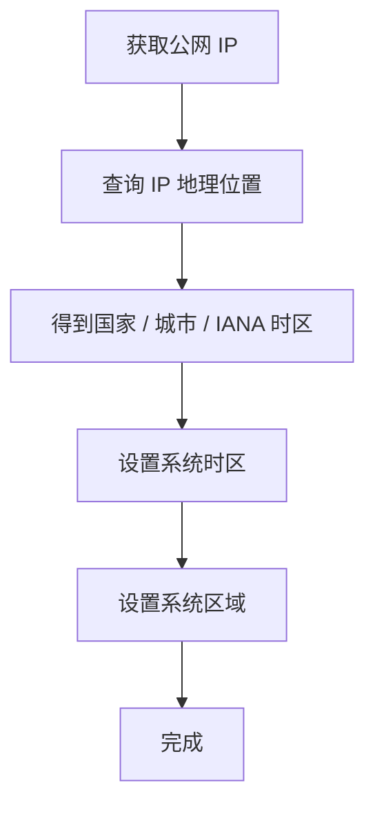

# 🌍 根据 IP 同步时间与区域

[English](README_EN.md) | 中文

一个根据 IP 地址自动同步时间、时区与区域设置的工具概念：读取当前公网 IP 的地理位置，自动匹配对应的时区与区域，不用手动查找和设置。

## ✨  idea

| 步骤 | 说明 |
|------|------|
| **获取公网 IP** | 查询当前设备的公网 IP 地址 |
| **IP 定位** | 通过 IP 地理库查出国家、地区、城市与 IANA 时区 |
| **同步时区** | 按定位结果设置系统时区 |
| **同步区域** | 按定位结果设置系统区域 |

## 🏗️ 工作原理

## 🚀 获取完整工具

本仓库目前只有概念说明，完整可用的 Windows 脚本请移步：

👉 **[Automatic-Time](https://github.com/jimu2000/Automatic-Time)** — 双击运行，自动提权、IP 定位、中英双语显示、自动设置 Windows 时区与区域。

## 📄 许可证

MIT License — 随便用。
