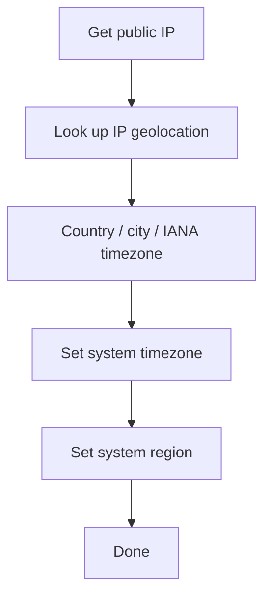

# 🌍 Sync Time & Region from IP

[中文](README.md) | English

A tool concept that automatically syncs time, timezone, and region settings from your IP address: look up the geolocation of your current public IP, then match the timezone and region automatically — no manual lookup or setup.

## ✨ Concept

| Step | Description |
|------|-------------|
| **Get public IP** | Query the device's current public IP address |
| **IP geolocation** | Look up country, region, city, and IANA timezone from an IP database |
| **Sync timezone** | Set the system timezone from the lookup result |
| **Sync region** | Set the system region from the lookup result |

## 🏗️ How It Works

## 🚀 Get the Full Tool

This repo currently holds the concept only. For a complete, ready-to-use Windows script, see:

👉 **[Automatic-Time](https://github.com/jimu2000/Automatic-Time)** — double-click to run, auto admin elevation, IP geolocation, bilingual display, automatic Windows timezone & region setup.

## 📄 License

MIT License — use it however you like.
